# Planificación del Proyecto, Control de Tareas e Inventario Real

**Índice**

1. [Metodología de trabajo y planificación (ProofHub y Git)](#1-metodología-de-trabajo-y-planificación-proofhub-y-git)
2. [Estándar de administración y auditoría (`bchecker`)](#2-estándar-de-administración-y-auditoría-bchecker)
3. [Inventario real verificado de infraestructura](#3-inventario-real-verificado-de-infraestructura)

---

## 1. Metodología de Trabajo y Planificación (ProofHub y Git)

La ejecución del proyecto se ha estructurado con una metodología ágil iterativa en **3 sprints quincenales de 10 horas cada uno (30 horas totales)**, combinando:

* **ProofHub** para la gestión de tareas, con un tablero Kanban en el proyecto **`P0.0-ASIXc2A-G02`**.
* **GitHub** (repositorio **`P0.0-ASIXc2A-02`**) para el control de versiones del código y de la documentación, con autenticación por par de claves SSH pública/privada y los comandos `git add`, `commit`, `push`, `pull` y `clone`.

<!-- CONFIRMAR: el enunciado fija la nomenclatura P0.0-ASIXc2gC-Gnn para el proyecto de ProofHub y para el repositorio. Comprobar que el nombre del repositorio (sin «G») coincide con el que se exige y, si no, renombrarlo en GitHub. -->

**Equipo:** Ivan y Jeremy.

**Evidencias del seguimiento:**

* El [diario de seguimiento](#16-diario-de-seguimiento-con-capturas-de-proofhub) (sección 1.6) recoge cada sesión con la captura del tablero de ProofHub correspondiente (carpeta `evidencias/proofhub/`).
* La retrospectiva del primer sprint (28/10) está registrada en el diario.

### 1.1. Tablero Kanban de ProofHub

El tablero usa seis columnas, que reflejan el ciclo de vida de cada tarea:

| Columna | Significado |
| :--- | :--- |
| **Pendents backlog (To Do)** | Tareas definidas en el backlog del proyecto, aún sin asignar a un sprint. |
| **Assignades sprint** | Tareas comprometidas para el sprint en curso. |
| **En curs (Doing)** | Tareas en ejecución. |
| **Bloquejades (Block)** | Tareas detenidas por una incidencia que impide avanzar. |
| **Pendents de Revisió (Review)** | Tareas terminadas a la espera de validación por el equipo. |
| **Finalitzades (Done)** | Tareas completadas y validadas. |

El backlog se definió el **07/10/2026 con 15 tareas** (una por cada requisito del enunciado). A lo largo del proyecto se añadieron tareas nuevas (ver 1.3), hasta un total de **20 tarjetas** en la última captura (10/11/2026).

### 1.2. Cronograma y control de sprints

<!-- CONFIRMAR: las fechas de inicio y fin de cada sprint se han deducido de las sesiones del diario. Ajustarlas a las fechas definidas en ProofHub. -->

| Sprint | Periodo | Objetivos y tareas ejecutadas | Entregable / evidencia | Estado |
| :--- | :--- | :--- | :--- | :--- |
| **Sprint 1** | 07/10 – 21/10/2026 | • Despliegue de Proxmox (`pvexx`), clientes Windows y Ubuntu y repositorio GitHub (07/10).<br>• Migración a la plataforma «Isard Nuvulet» (13/10).<br>• **Entorno de pruebas** con Docker: MySQL, generador CSV → SQL, PHP y Nginx, con una web CRUD funcional (20 y 21/10). | Diario: sesiones 07/10 a 21/10 | **Completado** |
| **Sprint 2** | 28/10 – 18/11/2026 | • Retrospectiva del sprint 1 y documentación en GitHub (28/10 y 03/11).<br>• Red de tres zonas: DMZ, Intranet y NAT.<br>• Creación de contenedores y servicios (04/11).<br>• Diagnóstico del filtro *Anti-MAC Spoofing* de IsardVDI y migración del enrutamiento, NAT, DNS y DHCP a Proxmox (10/11). | [01-arquitectura-red.md](../02-Redes-y-seguridad/01-arquitectura-red.md)<br>[02-configuracion-servidor-ftp.md](../03-servicios/02-configuracion-servidor-ftp.md)<br>[configuracion-servidor-BBDD.md](../03-servicios/configuracion-servidor-BBDD.md) | **Completado** tras la revisión del 18/11/2026 |
| **Sprint 3** | posterior al cierre del Sprint 2 | • Servidor de directorio `LDAP-NCC` (OpenLDAP, `ppolicy`, LAM) y login en el portal.<br>• Servidor web final `WEB-NCC` con portal CRUD.<br>• Manual de cliente, plan PRL, contingencia y juego de pruebas. | [03-configuracion-ldap.md](../03-servicios/03-configuracion-ldap.md)<br>[01-configuracion-servidor-web.md](../03-servicios/01-configuracion-servidor-web.md)<br>[manual-cliente.md](../04-manuales/manual-cliente.md)<br>[PRL.md](../04-manuales/05-Normativa-PRL/PRL.md)<br>[Contingencia-y-pruebas.md](../02-Redes-y-seguridad/Contingencia-y-pruebas.md) | Documentado. **Pendiente de reflejar en ProofHub** (ver 1.4) |

**Retrospectiva del sprint 1 (28/10/2026).** El equipo constató que se había priorizado el despliegue de Proxmox y de los servicios sobre la documentación. Decisión: dedicar las sesiones siguientes a documentar todo en GitHub, con carpetas por apartado e imágenes, y mantener esa práctica en los sprints 2 y 3.

### 1.3. Tareas del tablero de ProofHub

Estado según la **última captura disponible (10/11/2026)**. Las tarjetas marcadas con ★ no estaban en el backlog inicial: se crearon durante el proyecto.

| Tarjeta | Sprint | Vencimiento | Estado (10/11) | Documentación |
| :--- | :---: | :---: | :--- | :--- |
| Creación del nodo Proxmox | 1 | 08 Oct | Finalizada | [01-arquitectura-red.md](../02-Redes-y-seguridad/01-arquitectura-red.md) |
| Desplegar equipo Ubuntu | 1 | 08 Oct | Finalizada | [01-arquitectura-red.md](../02-Redes-y-seguridad/01-arquitectura-red.md) |
| Desplegar equipo Windows | 1 | 08 Oct | Finalizada | [01-arquitectura-red.md](../02-Redes-y-seguridad/01-arquitectura-red.md) |
| Creación de repositorio GitHub | 1 | — | Finalizada | Este repositorio |
| ★ Migración a Nuvulet | 1 | 14 Oct | Finalizada | [Diario, 13/10](#16-diario-de-seguimiento-con-capturas-de-proofhub) |
| ★ Entorno de pruebas | 1 | — | Finalizada | [Diario, 20 y 21/10](#16-diario-de-seguimiento-con-capturas-de-proofhub) |
| ★ Creación y configuración de Docker | 1 | 20 Oct | Finalizada | [configuracion-servidor-BBDD.md](../03-servicios/configuracion-servidor-BBDD.md) |
| Creación de la base de datos MySQL (`B-NCC`) | 1 | 20 Oct | Finalizada | [configuracion-servidor-BBDD.md](../03-servicios/configuracion-servidor-BBDD.md) |
| ★ Creación de generador (traducción de CSV a SQL) | 1 | 20 Oct | Finalizada | [configuracion-servidor-BBDD.md](../03-servicios/configuracion-servidor-BBDD.md) |
| ★ Desarrollo PHP (`index.php` y HTML de la web) | 1 | 20 Oct | Finalizada | [01-configuracion-servidor-web.md](../03-servicios/01-configuracion-servidor-web.md) |
| ★ Desplegar un servidor WEB Docker (`W-NCC`) | 1 | 20 Oct | Finalizada | [01-configuracion-servidor-web.md](../03-servicios/01-configuracion-servidor-web.md) |
| Creación base de la infraestructura de red | 2 | 04 Nov | Finalizada | [01-arquitectura-red.md](../02-Redes-y-seguridad/01-arquitectura-red.md) |
| Crear una DMZ | 2 | 04 Nov | Finalizada | [01-arquitectura-red.md](../02-Redes-y-seguridad/01-arquitectura-red.md) |
| Crear una NAT | 2 | 17 Nov | Finalizada | [01-arquitectura-red.md](../02-Redes-y-seguridad/01-arquitectura-red.md) |
| Crear una Intranet | 2 | 17 Nov | Finalizada | [01-arquitectura-red.md](../02-Redes-y-seguridad/01-arquitectura-red.md) |
| Desplegar un servidor DNS (resuelve `R-NCC` y `R`) | 2 | 04 Nov | **Bloqueada** | [01-arquitectura-red.md](../02-Redes-y-seguridad/01-arquitectura-red.md), sección 3.3 |
| Desplegar un servidor DHCP | 2 | 17 Nov | **Bloqueada** | [01-arquitectura-red.md](../02-Redes-y-seguridad/01-arquitectura-red.md), sección 3.3 |
| Desplegar un servidor FTP (`F-NCC`) | 2 | 17 Nov | En curso | [02-configuracion-servidor-ftp.md](../03-servicios/02-configuracion-servidor-ftp.md) |
| Desplegar un servidor SSH | 2 | 17 Nov | En curso | <!-- COMPLETAR: documento del servicio SSH --> |
| Documentación en Markdown | 2 | 27 Oct | En curso | Todo el repositorio |

**Cambios de estado pendientes de reflejar en ProofHub.** Según la documentación técnica, DNS y DHCP funcionan desde Proxmox (`dnsmasq` en `pvexx`, pruebas AUT-01 y AUT-02 de [Contingencia-y-pruebas.md](../02-Redes-y-seguridad/Contingencia-y-pruebas.md)). Las tarjetas figuraban como **Bloqueadas** el 10/11 y deben actualizarse a su estado real, con un comentario que enlace con la causa y la solución (*Anti-MAC Spoofing*, ver [diario, 10/11](#16-diario-de-seguimiento-con-capturas-de-proofhub)).

### 1.4. Trabajo documentado sin tarjeta propia en ProofHub

Parte del trabajo recogido en el repositorio **no tiene tarjeta en el tablero** de las capturas disponibles. Se registra aquí para mantener la trazabilidad entre la planificación, ProofHub y la documentación:

| Trabajo | Documentación | Fechas reales | Acción en ProofHub |
| :--- | :--- | :---: | :--- |
| Servidor web final `WEB-NCC` (Nginx + PHP-FPM en LXC) | [01-configuracion-servidor-web.md](../03-servicios/01-configuracion-servidor-web.md) | _completar_ | Crear tarjeta con la fecha real |
| Servidor `LDAP-NCC` y autenticación del portal | [03-configuracion-ldap.md](../03-servicios/03-configuracion-ldap.md) | _completar_ | Crear tarjeta con la fecha real |
| Manual de cliente | [manual-cliente.md](../04-manuales/manual-cliente.md) | _completar_ | Crear tarjeta con la fecha real |
| Plan de prevención de riesgos laborales | [PRL.md](../04-manuales/05-Normativa-PRL/PRL.md) | _completar_ | Crear tarjeta con la fecha real |
| Contingencia y juego de pruebas | [Contingencia-y-pruebas.md](../02-Redes-y-seguridad/Contingencia-y-pruebas.md) | _completar_ | Crear tarjeta con la fecha real |

Las tarjetas que se creen ahora deben llevar su **fecha de creación real** y un comentario que indique que se registran a posteriori y en qué fechas se ejecutó el trabajo.

### 1.5. Procedimiento de seguimiento

1. Cada sesión empieza y termina con una **entrada en el [diario](#16-diario-de-seguimiento-con-capturas-de-proofhub)** (sección 1.6): objetivo, trabajo realizado, incidencias y captura del tablero.
2. Las tarjetas se mueven por las columnas del tablero según su estado real. Cualquier bloqueo se mueve a *Bloquejades* con un comentario.
3. Cada cambio de configuración o de documentación se sube al repositorio con `git add`, `git commit -m "<descripción>"` y `git push`.
4. Al cerrar cada sprint se hace una **retrospectiva** y se prepara el siguiente.

### 1.6. Diario de seguimiento con capturas de ProofHub

Registro sesión por sesión del trabajo de **Ivan y Jeremy**, con la **captura del tablero de ProofHub** de cada jornada como evidencia. Los textos proceden del documento de seguimiento del equipo, con correcciones ortográficas menores. Las imágenes están en `evidencias/proofhub/`.

**Resumen de sesiones**

| Fecha | Sprint | Resumen | Horas | Evidencia |
| :--- | :---: | :--- | :---: | :--- |
| 07/10/2026 | 1 | Lluvia de ideas y reparto de máquinas. Despliegue de Proxmox y de los clientes Windows y Ubuntu. Creación del repositorio GitHub. | _completar_ | [Inicio](evidencias/proofhub/2026-10-07_inicio.png) · [Fin](evidencias/proofhub/2026-10-07_fin.png) |
| 13/10/2026 | 1 | Migración a la plataforma «Isard Nuvulet» y repetición del despliegue. Decisión de crear un entorno de pruebas. | _completar_ | [Tablero](evidencias/proofhub/2026-10-13_tablero.png) |
| 14/10/2026 | 1 | Sin avance: charla educativa. | — | [Tablero](evidencias/proofhub/2026-10-13_tablero.png) |
| 20/10/2026 | 1 | Entorno de pruebas con Docker: base de datos MySQL, generador CSV → SQL y configuración de Docker. | _completar_ | [Inicio](evidencias/proofhub/2026-10-20_inicio.png) · [Fin](evidencias/proofhub/2026-10-20_fin.png) |
| 21/10/2026 | 1 | Servidor web y desarrollo de la web de pruebas (CRUD sobre la base de datos). Inicio de la documentación. | _completar_ | [Inicio](evidencias/proofhub/2026-10-20_fin.png) · [Fin](evidencias/proofhub/2026-10-21_fin.png) |
| 28/10/2026 | 2 | Retrospectiva del sprint 1 y organización de la documentación en GitHub. | _completar_ | [Tablero](evidencias/proofhub/2026-10-28_tablero.png) |
| 03/11/2026 | 2 | Documentación en GitHub: carpetas por apartado, con imágenes. | _completar_ | [Tablero](evidencias/proofhub/2026-11-03_tablero.png) |
| 04/11/2026 | 2 | Creación de los contenedores y de la configuración de cada servidor. | _completar_ | [Inicio](evidencias/proofhub/2026-11-04_inicio.png) · [Fin](evidencias/proofhub/2026-11-04_fin.png) |
| 10/11/2026 | 2 | Diagnóstico del fallo de DHCP en el contenedor router: filtro *Anti-MAC Spoofing* de IsardVDI. | _completar_ | [Inicio](evidencias/proofhub/2026-11-10_inicio.png) · [Fin](evidencias/proofhub/2026-11-10_fin.png) |
| 17/11/2026 | 2 | Configuración y documentación del servicio LDAP. | _completar_ | Captura pendiente de incorporar al repositorio (recibida) |

**Registro diario**

#### 07/10/2026 · Sprint 1

**Inicio.** Se hace una lluvia de ideas sobre las tareas pendientes: cómo se distribuirá cada máquina, cuál será su estructura, qué tipo de servidor se despliega en cada una y qué funcionalidades incluye el proyecto.

**Fin.** Se cumple el objetivo del día: se despliega el servidor Proxmox y los clientes Windows y Ubuntu, desde los que se accede a la interfaz web de gestión de las máquinas virtuales de Proxmox.

**Tablero ProofHub.** El proyecto arranca con **15 tareas** (0/15 completadas): 8 en backlog (entre ellas servidor WEB `W-NCC`, SSH, base de datos MySQL `B-NCC`, DHCP y DNS), 4 asignadas al sprint (Crear DMZ, Crear Intranet, Crear NAT y Desplegar equipo Windows) y 3 en curso (Creación del nodo Proxmox, Desplegar equipo Ubuntu y Creación del repositorio GitHub). Al final del día pasan a *Finalitzades* el nodo Proxmox, los equipos Ubuntu y Windows y el repositorio GitHub.

**Evidencia.**

*Inicio:*

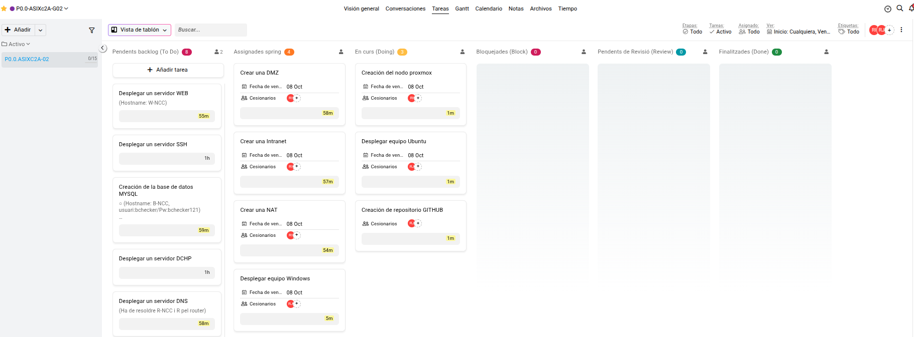

*Fin:*

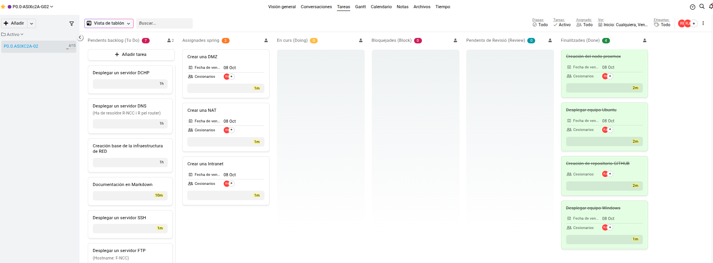


#### 13/10/2026 · Sprint 1

**Inicio.** Se ponen en común los resultados del 07/10 (clientes desplegados y red configurada con Proxmox). Como todo el despliegue se había hecho en la plataforma «Isard» y daba muchos problemas, se decide **cambiar a «Isard Nuvulet»**, con más fiabilidad y mayor cuota de recursos. El día se dedica a repetir las tareas del 07/10 en la nueva plataforma.

**Fin.** Se llega al mismo punto en que se quedó el 07/10. Se decide crear un **entorno de pruebas** antes de desarrollar el proyecto completo, para evaluar su eficiencia.

**Tablero ProofHub.** Cuatro tareas finalizadas (nodo Proxmox, equipos Ubuntu y Windows, repositorio GitHub). Crear DMZ, Crear NAT y Crear Intranet siguen asignadas al sprint con vencimiento 13 Oct. El resto, en backlog.

**Evidencia.**

*Tablero:*

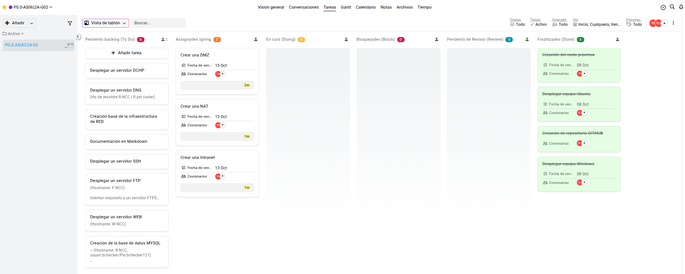

*El tablero no cambia entre el inicio y el fin de la jornada.*


#### 14/10/2026 · Sprint 1

El objetivo era desplegar el entorno de pruebas en un contenedor, pero una **charla educativa** impidió avanzar. El trabajo se retoma en la siguiente sesión.

**Tablero ProofHub.** Sin cambios respecto al 13/10.

**Evidencia.**

*Tablero:*


#### 20/10/2026 · Sprint 1

**Inicio.** Se ponen en común los avances. Tras los inconvenientes de los últimos días (la migración y la charla), hay que avanzar bastante. El objetivo es **desplegar un contenedor Docker de pruebas** con un sistema parecido al que se quiere implementar, como guía.

**Fin.** Se avanza en la mayoría de las tareas del día. Queda pendiente el desarrollo de la web desde la que acceder a la base de datos, con el objetivo de poder **crear, editar y eliminar** información.

**Tablero ProofHub.**
* *Al inicio:* en curso, Creación y configuración de Docker, Creación de generador (traducción de CSV a SQL) y Creación de la base de datos MySQL (`B-NCC`); asignadas al sprint, Documentación en Markdown (27 Oct), Desplegar un servidor WEB Docker (`W-NCC`) y Desarrollo PHP; en revisión, Entorno de pruebas. Aparece la tarjeta *Migración a Nuvulet* (vencimiento 14 Oct) entre las finalizadas.
* *Al final:* finalizadas la base de datos MySQL, el generador y la configuración de Docker.

**Evidencia.**

*Inicio:*

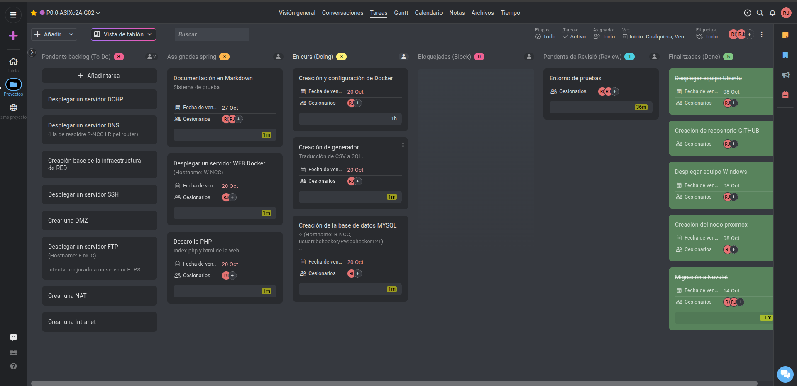

*Fin:*

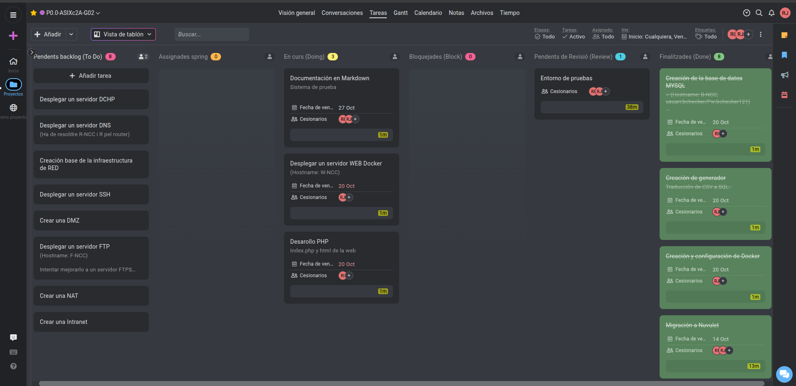


#### 21/10/2026 · Sprint 1

**Inicio.** Se retoma el desarrollo de la web del entorno de pruebas: Jeremy e Ivan instalan el servidor web y desarrollan el HTML.

**Fin.** La web queda **acabada y funcional**, con los requisitos propuestos cumplidos. El tiempo restante se aprovecha para avanzar con la documentación.

**Tablero ProofHub.** *Finalitzades:* 10 tareas, entre ellas Desarrollo PHP (`index.php` y HTML de la web) y Desplegar un servidor WEB Docker. *En curso:* Documentación en Markdown (27 Oct). *En revisión:* Entorno de pruebas. *Backlog (8):* DHCP, DNS, base de la infraestructura de red, SSH, DMZ, FTP, NAT e Intranet.

**Evidencia.**

*Inicio:*


*Fin:*

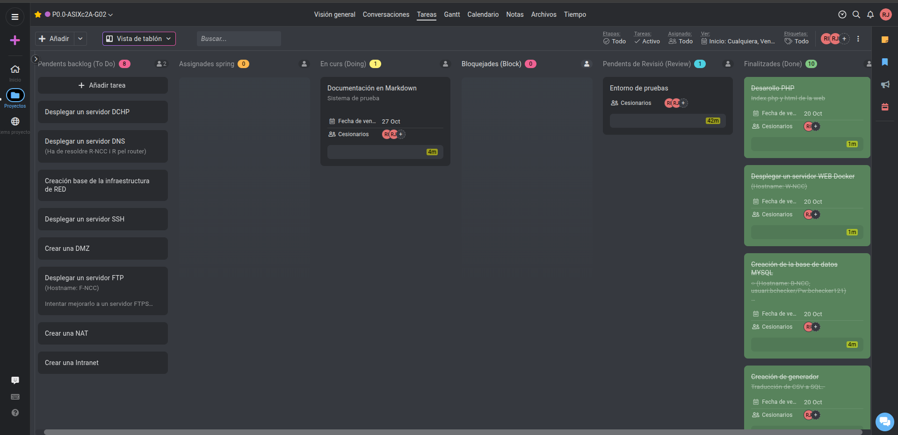


#### 28/10/2026 · Sprint 2

**Inicio.** Cerrado el primer sprint, el equipo detecta que se ha centrado más en montar Proxmox y los servicios que en la documentación necesaria, que es imprescindible para mantener una buena organización. Se decide **documentarlo todo directamente en GitHub** en los días siguientes y preparar el segundo sprint.

**Fin.** Organización y esquema de la documentación hechos; la redacción empieza el siguiente día.

**Tablero ProofHub.** *En curso:* Documentación en Markdown (27 Oct). *En revisión:* Entorno de pruebas y Creación y configuración de Docker. *Backlog:* DHCP, DNS, base de la infraestructura de red, SSH, DMZ, FTP, NAT e Intranet.

**Evidencia.**

*Tablero:*

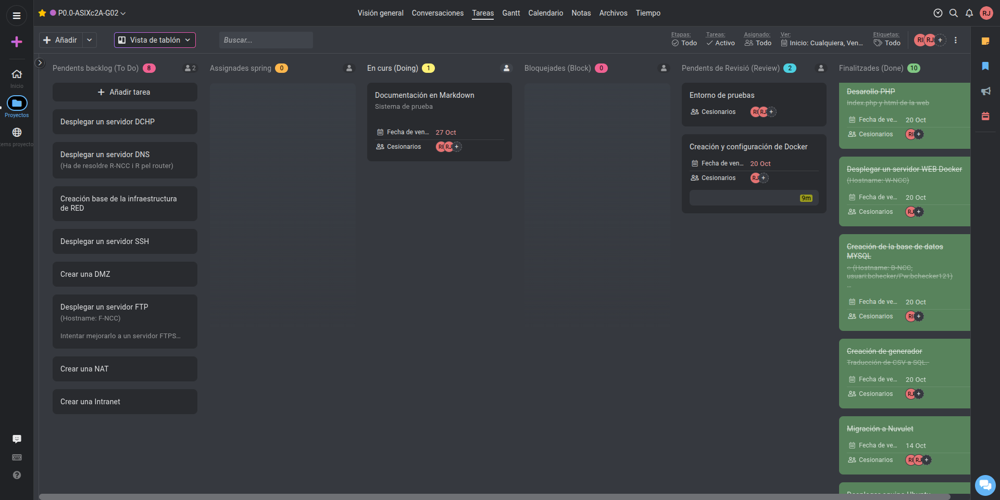


#### 03/11/2026 · Sprint 2

**Inicio.** Se empieza a documentar en GitHub, con carpetas por cada paso realizado y sus imágenes.

**Fin.** La documentación avanza de forma notable a partir de los borradores e imágenes que ya existían.

**Tablero ProofHub.** Igual que el 28/10.

**Evidencia.**

*Tablero:*

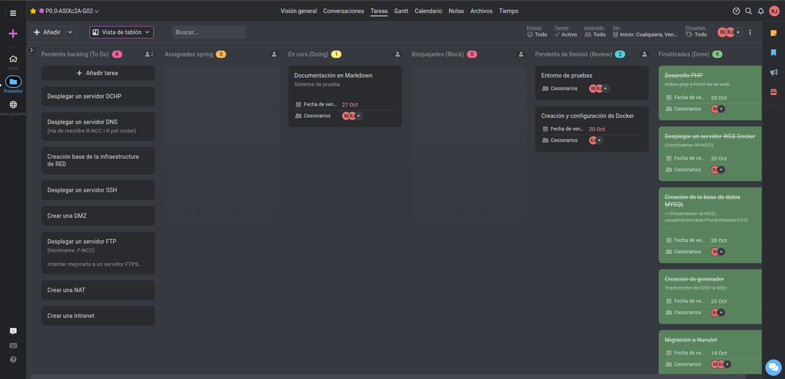


#### 04/11/2026 · Sprint 2

**Inicio.** Se pone en común la documentación redactada en GitHub. El objetivo es empezar a **crear los contenedores y la configuración de cada servidor** con sus servicios.

**Fin.** Jornada productiva: como los esquemas de red y las configuraciones ya estaban hechos, la creación de servidores y servicios se agiliza. Quedan algunos pendientes para la siguiente sesión.

**Tablero ProofHub.**
* *Al inicio:* en curso, base de la infraestructura de red, Crear DMZ y Desplegar un servidor DNS (vencimiento 04 Nov) junto con la documentación; backlog, SSH, FTP (con la nota «intentar mejorarlo a un servidor FTPS»), NAT, Intranet y DHCP (17 Nov).
* *Al final:* finalizadas **12** tareas, entre ellas Crear DMZ y la base de la infraestructura de red; **Desplegar un servidor DNS pasa a *Bloquejades***; en revisión, Creación y configuración de Docker; en backlog, SSH, FTP, NAT, Intranet y DHCP.

**Evidencia.**

*Inicio:*

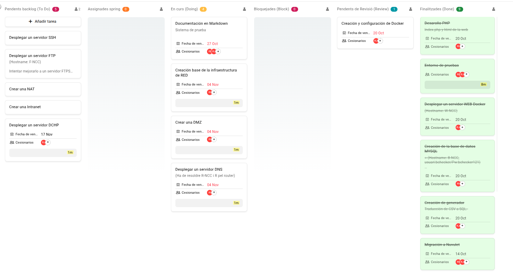

*Fin:*

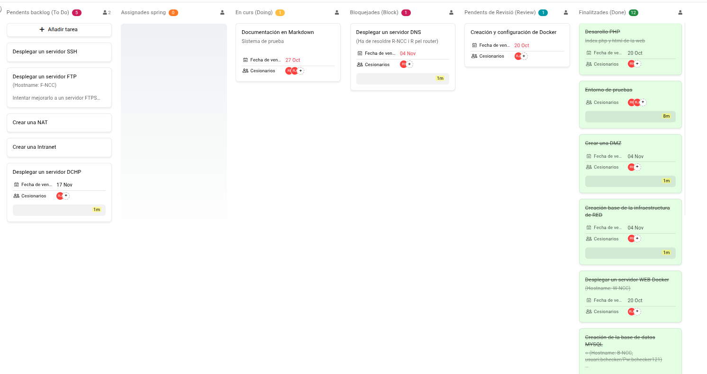


#### 10/11/2026 · Sprint 2

**Inicio.** Al final de la jornada anterior se detectó que algo no funcionaba en el DHCP del contenedor que hace de router. El objetivo del día es terminar los servidores que faltan y descubrir el fallo.

**Fin.** Se avanza con casi todo, pero se dedica mucho tiempo al router. La investigación concluye que hay un problema entre IsardVDI y Proxmox: el conmutador virtual de IsardVDI aplica un filtro **Anti-MAC Spoofing** que solo autoriza el tráfico procedente de la MAC original de la interfaz `enp3s0` de Proxmox. El contenedor router (`R-NCC`) respondía a las peticiones DHCP con su propia MAC virtual, distinta, y IsardVDI descartaba esos paquetes. **Al mover el servidor DHCP directamente a Proxmox (`vmbr2`)**, las respuestas salen con la MAC autorizada de `enp3s0`.

**Tablero ProofHub.**
* *Al inicio:* en curso, Crear NAT, Crear Intranet, Desplegar un servidor DHCP, FTP y SSH (vencimiento 17 Nov); bloqueada, DNS; en revisión, Creación y configuración de Docker.
* *Al final:* **15** tareas finalizadas (incluidas Crear NAT, Crear Intranet, Docker y Crear DMZ); en curso, Documentación en Markdown, FTP y SSH; **bloqueadas, DNS y DHCP**.

**Evidencia.**

*Inicio:*

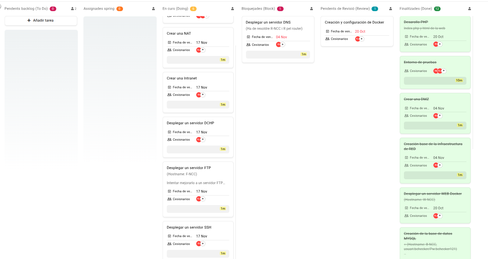

*Fin:*

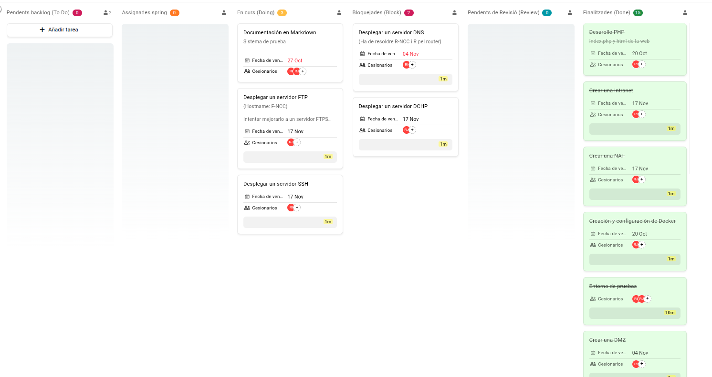


#### 17/11/2026 · Sprint 3

<!-- COMPLETAR con lo realmente hecho ese día y adjuntar la captura del tablero. -->

_Entrada pendiente de redactar._

### 1.7. Incidencias y decisiones relevantes

| Fecha | Incidencia o decisión | Causa | Resolución | Impacto |
| :--- | :--- | :--- | :--- | :--- |
| 13/10 | Cambio de plataforma a «Isard Nuvulet» | Problemas de fiabilidad y falta de recursos en la plataforma inicial | Migración y repetición del despliegue del 07/10 | Se pierde una jornada de trabajo |
| 13/10 | Entorno de pruebas previo | Evaluar la solución antes del desarrollo completo | Contenedor Docker con MySQL, PHP y Nginx (20 y 21/10) | Sirve de guía para el diseño final |
| 14/10 | Jornada sin trabajo | Charla educativa | Se retoma el 20/10 | Retraso en el sprint 1 |
| 28/10 | **Retrospectiva del sprint 1** | Se priorizó el despliegue sobre la documentación | Se dedican las siguientes sesiones a documentar en GitHub | Se corrige la prioridad en el sprint 2 |
| 10/11 | Fallo de DHCP en el contenedor `R-NCC` | Filtro *Anti-MAC Spoofing* de IsardVDI | Enrutamiento, NAT, DNS y DHCP movidos a Proxmox (`pvexx`) | El router pasa a ser un rol del hipervisor (ver `02-Redes-y-seguridad/01-arquitectura-red.md`) |

---

## 2. Estándar de Administración y Auditoría (`bchecker`)

Para facilitar las tareas de evaluación, auditoría y administración transversal en todos los sistemas operativos, servicios y contenedores del proyecto, se ha estandarizado la cuenta administrativa obligatoria:
* **Usuario:** `bchecker`
* **Contraseña de auditoría:** `bchecker121`
* **Ámbito de aplicación:**
  * **Sistemas Linux (Hosts/LXC):** Cuenta local con shell `/bin/bash` y pertenencia al grupo `sudo`.
  * **Servidor FTP (`F-NCC`):** Usuario autenticado en ProFTPD con directorio raíz `/home/bchecker`.
  * **Base de Datos (`B-NCC`):** Usuario MySQL con permisos completos (`ALL PRIVILEGES ON bcn_educacio.*`).
  * **Directorio LDAP (`LDAP-NCC`):** Entrada `uid=bchecker,ou=usuarios,dc=educacion,dc=local` para pruebas de autenticación y políticas de bloqueo `ppolicy`.

```bash
# Creación del usuario estándar de administración en nodos Linux
useradd -m -s /bin/bash bchecker
echo "bchecker:bchecker121" | chpasswd
usermod -aG sudo bchecker
```

---

## 3. Inventario Real Verificado de Infraestructura

| ID | Hostname | Tipo de Recurso | Sistema Operativo | IP / Subred | Puente Proxmox | Servicios Desplegados | Estado |
| :--- | :--- | :--- | :--- | :--- | :--- | :--- | :--- |
| **Host** | `pvexx` | Nodo Hipervisor (VM IsardVDI) | Debian GNU/Linux (Proxmox VE) | `10.2.169.223` (VPN)<br>`10.10.10.1/24` (DMZ)<br>`10.10.20.1/24` (Intranet)<br>`192.168.2.1/24` (Clientes) | `vmbr0`, `vmbr1`, `vmbr1:0`, `vmbr2` | Virtualización KVM/LXC, Router central, NAT/DNAT (`iptables`), DNS y DHCP (`dnsmasq`). | **Activo** |
| **CT 102** | `CLI-LINUX` | Contenedor LXC | Ubuntu Server | `192.168.2.50` – `.150` (DHCP) | `vmbr2` | Cliente Linux para pruebas DHCP (Opción 121), DNS, HTTP, FTP y ping inter-red. | **Activo** |
| **CT 103** | `R-NCC` | Contenedor LXC | Ubuntu Server | `10.10.10.1` / `10.10.20.1` *(histórico)* | `vmbr1`, `vmbr2` | Router inicial retirado tras detectar filtro *Anti-MAC Spoofing* en IsardVDI. | **Detenido (Retirado)** |
| **CT 104** | `Servidor-FTP` (`F-NCC`) | Contenedor LXC + Docker | Ubuntu + Docker Engine | `10.10.10.10/24` (DMZ) | `vmbr1` | Contenedor `ftp_bcn` (`delfer/proftpd`) en puerto `21` y rango pasivo `60000-60010`. | **Activo** |
| **CT 105** | `WEB-NCC` (`W-NCC`) | Contenedor LXC | Ubuntu Server | `10.10.10.20/24` (DMZ) | `vmbr1` | `Nginx` + `PHP 8.2-FPM` (`php-ldap`, `php-mysql`), portal CRUD `educacion.local`. | **Activo** |
| **CT 106** | `B-NCC` | Contenedor LXC + Docker | Ubuntu + Docker Compose | `10.10.20.10/24` (Intranet) | `vmbr1:0` | Stack Compose: `mysql_bcn_db` (`mysql:8.0`), `php_bcn_app`, `nginx_bcn_web`. BD `bcn_educacio`. | **Activo** |
| **CT** | `LDAP-NCC` | Contenedor LXC | Debian / Ubuntu | `10.10.10.30/24` (DMZ) | `vmbr1` | Demonio `slapd` (OpenLDAP `dc=educacion,dc=local`), *overlay* `ppolicy`, Apache2 + LAM (`/lam`). | **Activo** |
| **VM** | `CLI-WIN` | Máquina Virtual / Host | Windows 10/11 | `192.168.2.50` – `.150` (LAN) / `10.2.x.x` (VPN) | `vmbr2` / `enp2s0` | Cliente Windows para pruebas de navegador, `ipconfig`, rutas DHCP 121 y acceso remoto VPN. | **Activo** |
