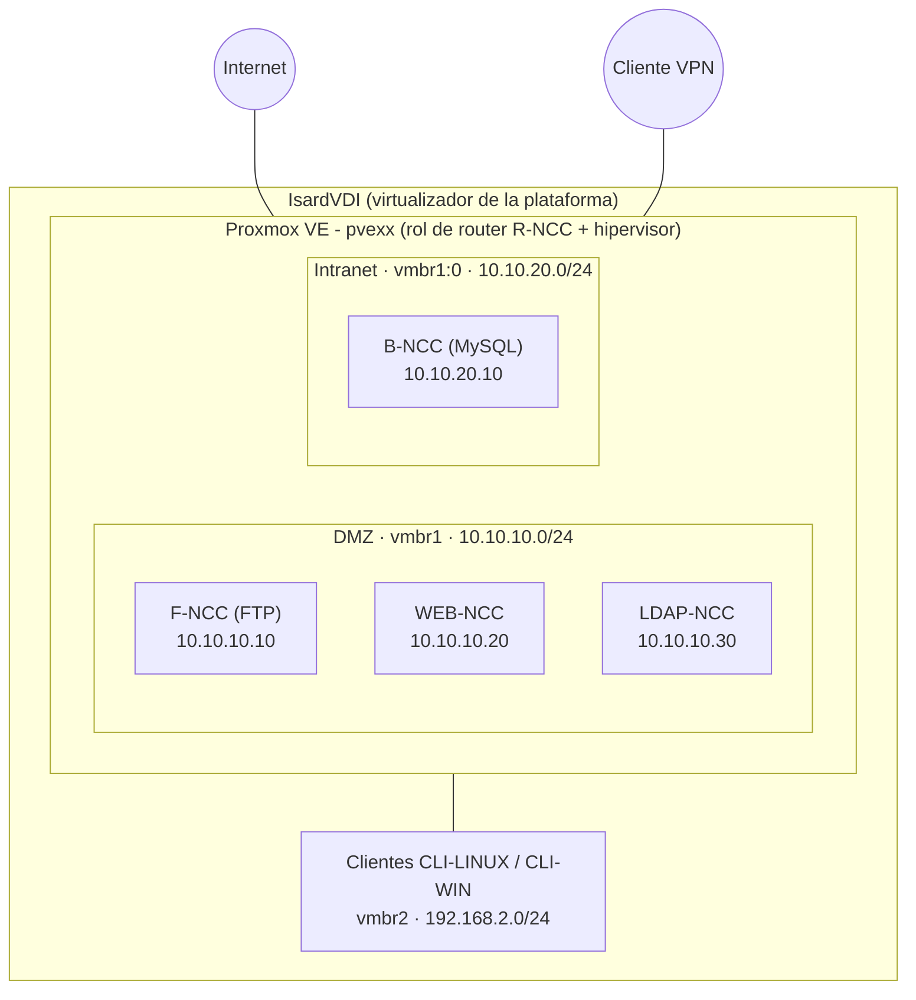

# Arquitectura de Red Centralizada, Reglas Persistentes y Evolución desde `R-NCC`

Este documento especifica la topología de red desplegada sobre **Proxmox VE (`pvexx`)** en **IsardVDI**, explica la migración técnica desde el contenedor router inicial **`R-NCC`** hacia el hipervisor, describe la estructura de cada nodo de la infraestructura y detalla la configuración persistente de interfaces, cortafuegos (`iptables`), DNS y DHCP (`dnsmasq`).

**Índice**

0. [Contexto del entorno y decisiones de diseño](#0-contexto-del-entorno-y-decisiones-de-diseño)
1. [Evolución arquitectónica: del router `R-NCC` al enrutamiento en Proxmox](#1-evolución-arquitectónica-del-router-r-ncc-al-enrutamiento-en-proxmox)
2. [Diagrama de topología consolidada](#2-diagrama-de-topología-consolidada)
3. [Configuración persistente en Proxmox VE (`pvexx`)](#3-configuración-persistente-en-proxmox-ve-pvexx)
4. [Configuración de red de los nodos internos (Netplan)](#4-configuración-de-red-de-los-nodos-internos-netplan)
5. [Estructura y servicios de cada nodo](#5-estructura-y-servicios-de-cada-nodo)

---

## 0. Contexto del entorno y decisiones de diseño

### 0.1. Entorno de despliegue (virtualización anidada)

La infraestructura no se ejecuta sobre hardware físico, sino sobre **IsardVDI**, que ofrece una máquina virtual con tres interfaces de red. Dentro de esa máquina se instala **Proxmox VE (`pvexx`)**, que a su vez aloja los contenedores LXC y Docker del proyecto. Es decir, hay **dos capas de virtualización**:



### 0.2. Interfaces de red de la máquina IsardVDI

| Interfaz | Puente Proxmox | Función | Requisito del enunciado |
|---|---|---|---|
| `enp1s0` | `vmbr0` | Salida a Internet (DHCP de IsardVDI) | Red NAT |
| `enp2s0` | — (IP propia, MTU 1446) | Acceso por VPN y redirección de puertos 80/443 hacia `WEB-NCC` | Acceso externo |
| `enp3s0` | `vmbr2` | Red local interna de clientes (`192.168.2.0/24`) | Red de clientes |

Las redes **DMZ** (`vmbr1`, `10.10.10.0/24`) e **Intranet** (`vmbr1:0`, `10.10.20.0/24`) son internas de Proxmox y no tienen interfaz física asociada.

### 0.3. Decisión: el router `R-NCC` se implementa en el propio Proxmox

| | |
|---|---|
| **Requisito** | El enunciado pide un router `R-NCC` con tres redes (DMZ, Intranet, NAT). |
| **Primer diseño** | Contenedor LXC `R-NCC` (`CT 103`) con tres interfaces, NAT (`iptables`) y `dnsmasq`. |
| **Problema** | Los clientes están en la red local de IsardVDI (`enp3s0`). El conmutador virtual de IsardVDI solo admite tramas con la MAC registrada para esa interfaz y descarta las demás (*Anti-MAC Spoofing*). Los `DHCP OFFER` enviados desde el LXC, con su MAC virtual propia, no llegaban a los clientes. |
| **Decisión** | Mover el enrutamiento, NAT/DNAT, `dnsmasq` (DNS y DHCP) y el ajuste `TCPMSS` a **`pvexx`**, de modo que todo el tráfico hacia los clientes sale con la MAC autorizada. |
| **Consecuencia** | `R-NCC` pasa a ser un **rol** (router de la infraestructura) cubierto por `pvexx`. El `CT 103` se conserva detenido como referencia del diseño inicial. |

> Las direcciones `10.10.10.1`, `10.10.20.1` y los puentes `vmbr1`/`vmbr2` que aparecían en el diseño de `CT 103` son **históricas**. La referencia vigente es la sección 3.

### 0.4. Limitación: MTU 1446 por encapsulación VXLAN

IsardVDI encapsula el tráfico en VXLAN, lo que reduce el MTU efectivo a 1446 bytes. Se ha configurado `mtu 1446` en `enp2s0`, `enp3s0` y `vmbr2`, y se aplica `TCPMSS --clamp-mss-to-pmtu` en `FORWARD` para evitar la fragmentación en conexiones HTTP/TLS.

### 0.5. Resolución de nombres del router

Como `R-NCC` es un rol del hipervisor, el DNS (`dnsmasq`) resuelve sus dos nombres exigidos en el enunciado (`R-NCC` y `R`) hacia las direcciones del router en cada red (ver sección 3.3):

```ini
host-record=r-ncc,r,10.10.10.1,10.10.20.1,192.168.2.1
```

---

## 1. Evolución Arquitectónica: Del Router `R-NCC` al Enrutamiento en Proxmox

### 1.1. Diseño Inicial de 3 Patas (`CT 103 - R-NCC`)

En la primera fase del proyecto se implementó un contenedor LXC dedicado denominado **`R-NCC` (`CT 103`)** configurado con tres interfaces de red (`eth0` en `vmbr0` para WAN, `eth1` en `vmbr1` con IP `10.10.10.1/24` para la DMZ y `eth2` en `vmbr2` con IP `10.10.20.1/24` para la Intranet), ejecutando Netplan, enmascaramiento NAT y `dnsmasq`. *(Diseño histórico: en la arquitectura vigente `vmbr2` es la red de clientes.)*

### 1.2. Limitación Técnica Detectada en IsardVDI (*Anti-MAC Spoofing* y VXLAN)

Al validar la entrega de direcciones IP por DHCP hacia las máquinas cliente conectadas a la red privada de IsardVDI (`enp3s0`), se detectaron dos comportamientos críticos de la plataforma de virtualización:

1. **Filtro de Seguridad de Capa 2 (*Port Security / Anti-MAC Spoofing*):** El switch virtual de IsardVDI registra únicamente la dirección MAC original de la interfaz `enp3s0` asignada a la máquina virtual de Proxmox. Cualquier trama Ethernet saliente con una MAC de origen distinta es descartada automáticamente. Como el contenedor `R-NCC` operaba en modo puente con su propia dirección MAC virtual, sus paquetes `DHCP OFFER` eran bloqueados por IsardVDI antes de llegar a los clientes.
2. **Encapsulación VXLAN (`MTU 1446`):** La red virtualizada de IsardVDI añade cabeceras VXLAN sobre las tramas Ethernet, reduciendo el MTU efectivo a **1446 bytes**. Sin ajuste de *Maximum Segment Size* (`TCPMSS`), las conexiones HTTP/TLS de gran tamaño sufren fragmentación y bloqueos.

### 1.3. Solución Arquitectónica Adoptada

Se detuvo el contenedor `R-NCC` (`CT 103`, conservado como referencia del diseño inicial) y se centralizaron las funciones de **enrutamiento IPv4, NAT/DNAT (`iptables`), ajuste `TCPMSS` y servidor DNS/DHCP (`dnsmasq`)** directamente en el hipervisor **Proxmox VE (`pvexx`)**. De esta manera, todo el tráfico hacia los clientes sale a través de `vmbr2` utilizando la dirección MAC autorizada de `enp3s0`, resolviendo el bloqueo de capa 2 de forma definitiva.

---

## 2. Diagrama de Topología Consolidada

```text
                       [ Internet / IsardVDI WAN ]
                                    │
                             enp1s0 / vmbr0 (DHCP)
                                    │
   [ Cliente VPN ] ──► enp2s0 (10.2.169.223 / MTU 1446)
                         │  (DNAT TCP 80/443 -> 10.10.10.20)
                         ▼
              ┌─────────────────────────────────────┐
              │       PROXMOX VE (pvexx)            │
              │  Router · Gateway · NAT · dnsmasq   │
              └───┬──────────────┬──────────────┬───┘
                  │              │              │
       vmbr1 (10.10.10.1)   vmbr1:0 (10.10.20.1)   vmbr2 + enp3s0 (192.168.2.1)
       Zona DMZ             Zona Intranet          Red Clientes Locales (DHCP)
         │                    │                      │
         ├──► 10.10.10.10     └──► 10.10.20.10       └──► 192.168.2.50 - .150
         │    F-NCC (FTP)          B-NCC (MySQL)          CLI-LINUX / CLI-WIN
         ├──► 10.10.10.20
         │    WEB-NCC (Web)
         └──► 10.10.10.30
              LDAP-NCC (LDAP)
```

---

## 3. Configuración Persistente en Proxmox VE (`pvexx`)

### 3.1. Reenvío de Paquetes en el Kernel (`/etc/sysctl.conf`)

```ini
net.ipv4.ip_forward=1
```

### 3.2. Interfaces, Puentes y Reglas `iptables` (`/etc/network/interfaces`)

Se incluyen eventos `post-up` y `post-down` para garantizar la persistencia tras reinicios y evitar reglas duplicadas al recargar con `ifreload -a`:

```bash
auto lo
iface lo inet loopback

iface enp1s0 inet manual

# 1. Salida a Internet (IsardVDI WAN)
auto vmbr0
iface vmbr0 inet dhcp
	bridge-ports enp1s0
	bridge-stp off
	bridge-fd 0

# 2. Interfaz VPN (IsardVDI) - Redirección de puertos hacia WEB-NCC
auto enp2s0
iface enp2s0 inet dhcp
	mtu 1446
	post-up sysctl -w net.ipv4.ip_forward=1
	post-up iptables -t nat -A PREROUTING -i enp2s0 -p tcp --dport 80 -j DNAT --to-destination 10.10.10.20:80
	post-up iptables -t nat -A PREROUTING -i enp2s0 -p tcp --dport 443 -j DNAT --to-destination 10.10.10.20:443
	post-up iptables -I FORWARD 1 -i enp2s0 -o vmbr1 -j ACCEPT
	post-up iptables -I FORWARD 1 -i vmbr1 -o enp2s0 -m state --state RELATED,ESTABLISHED -j ACCEPT
	post-up iptables -I FORWARD 1 -p tcp --tcp-flags SYN,RST SYN -j TCPMSS --clamp-mss-to-pmtu
	post-down iptables -t nat -D PREROUTING -i enp2s0 -p tcp --dport 80 -j DNAT --to-destination 10.10.10.20:80
	post-down iptables -t nat -D PREROUTING -i enp2s0 -p tcp --dport 443 -j DNAT --to-destination 10.10.10.20:443
	post-down iptables -D FORWARD -i enp2s0 -o vmbr1 -j ACCEPT
	post-down iptables -D FORWARD -i vmbr1 -o enp2s0 -m state --state RELATED,ESTABLISHED -j ACCEPT
	post-down iptables -D FORWARD -p tcp --tcp-flags SYN,RST SYN -j TCPMSS --clamp-mss-to-pmtu

iface enp3s0 inet manual
	mtu 1446

# 3. Zona DMZ - Servidores Internos (WEB-NCC, F-NCC, LDAP-NCC)
auto vmbr1
iface vmbr1 inet static
	address 10.10.10.1/24
	bridge-ports none
	bridge-stp off
	bridge-fd 0
	post-up iptables -A FORWARD -i vmbr1 -o vmbr1 -j ACCEPT
	post-up iptables -t nat -A POSTROUTING -o vmbr1 -j MASQUERADE
	post-down iptables -D FORWARD -i vmbr1 -o vmbr1 -j ACCEPT
	post-down iptables -t nat -D POSTROUTING -o vmbr1 -j MASQUERADE

# 3.1. Zona Intranet - Pasarela para Base de Datos (B-NCC 10.10.20.10)
auto vmbr1:0
iface vmbr1:0 inet static
	address 10.10.20.1/24

# 4. Red Clientes Locales (Conectada a enp3s0 - Pasarela 192.168.2.1)
auto vmbr2
iface vmbr2 inet static
	address 192.168.2.1/24
	bridge-ports enp3s0
	bridge-stp off
	bridge-fd 0
	mtu 1446
	post-up iptables -t nat -A POSTROUTING -o vmbr2 -j MASQUERADE
	post-up iptables -t nat -A POSTROUTING -o vmbr0 -j MASQUERADE
	post-down iptables -t nat -D POSTROUTING -o vmbr2 -j MASQUERADE
	post-down iptables -t nat -D POSTROUTING -o vmbr0 -j MASQUERADE

source /etc/network/interfaces.d/*
```

### 3.3. Servidor DNS y DHCP (`/etc/dnsmasq.conf`)

El servicio `dnsmasq` escucha en `enp2s0`, `vmbr2` y `vmbr1`, resuelve de forma autoritativa el dominio `educacion.local` y los nombres de host de la infraestructura, y entrega direccionamiento DHCP en `vmbr2` inyectando la ruta hacia `10.10.10.0/24` mediante la **Opción DHCP 121**:

```ini
interface=enp2s0
interface=vmbr2
interface=vmbr1

domain-needed
bogus-priv
no-resolv
no-poll

# Reenviadores DNS externos para navegación a Internet
server=1.1.1.1
server=8.8.8.8

# Dominio local autoritativo
domain=educacion.local
local=/educacion.local/
expand-hosts

# Resolución DNS interna
address=/educacion.local/10.10.10.20
address=/www.educacion.local/10.10.10.20
address=/web-ncc/10.10.10.20
address=/w-ncc/10.10.10.20
address=/f-ncc/10.10.10.10
address=/ldap-ncc/10.10.10.30
address=/b-ncc/10.10.20.10

# Router (rol R-NCC, implementado en pvexx): nombres R-NCC y R
host-record=r-ncc,r,10.10.10.1,10.10.20.1,192.168.2.1
addn-hosts=/etc/hosts

cache-size=1000
log-queries
log-facility=/var/log/dnsmasq.log
except-interface=lo

# Rango DHCP para clientes en vmbr2 + inyección de ruta estática (Opción 121)
dhcp-range=interface:vmbr2,192.168.2.50,192.168.2.150,255.255.255.0,12h
dhcp-option=option:router,192.168.2.1
dhcp-option=option:dns-server,192.168.2.1
dhcp-option=option:domain-name,"educacion.local"
dhcp-option=121,10.10.10.0/24,192.168.2.1
```

Verificación desde un cliente:

```bash
nslookup r-ncc
nslookup r
```

---

## 4. Configuración de Red de los Nodos Internos (Netplan)

### 4.1. Servidor Web (`WEB-NCC` — `10.10.10.20`)

```yaml
network:
  version: 2
  ethernets:
    eth0:
      dhcp4: true
    eth1:
      addresses:
        - 10.10.10.20/24
      routes:
        - to: 10.10.20.0/24
          via: 10.10.10.1
        - to: 192.168.2.0/24
          via: 10.10.10.1
```

### 4.2. Servidor FTP (`F-NCC` — `10.10.10.10`)

```yaml
network:
  version: 2
  ethernets:
    eth0:
      dhcp4: true
    eth1:
      addresses:
        - 10.10.10.10/24
      routes:
        - to: 10.10.20.0/24
          via: 10.10.10.1
        - to: 192.168.2.0/24
          via: 10.10.10.1
```

### 4.3. Servidor de Base de Datos (`B-NCC` — `10.10.20.10`)

```yaml
network:
  version: 2
  ethernets:
    net0:
      dhcp4: true
    net1:
      dhcp4: no
      addresses:
        - 10.10.20.10/24
      routes:
        - to: default
          via: 10.10.20.1
      nameservers:
        addresses:
          - 10.10.20.1
```

### 4.4. Cliente Linux (`CLI-LINUX` — DHCP en `vmbr2`)

```yaml
network:
  version: 2
  renderer: networkd
  ethernets:
    enp3s0:
      dhcp4: true
      mtu: 1446
      dhcp4-overrides:
        use-routes: true
        use-dns: true
```

### 4.5. Servidor LDAP (`LDAP-NCC` — `10.10.10.30`)

<!-- TODO: añadir aquí el Netplan real de LDAP-NCC (no estaba en el documento original). -->

---

## 5. Estructura y servicios de cada nodo

### 5.1. Resumen de la infraestructura

| ID | Hostname | Tipo | Sistema operativo | IP | Red / puente | Servicios | Estado |
|---|---|---|---|---|---|---|---|
| Host | `pvexx` | VM en IsardVDI (Proxmox VE) | Debian GNU/Linux | `10.2.169.223` (VPN), `10.10.10.1`, `10.10.20.1`, `192.168.2.1` | `vmbr0`, `vmbr1`, `vmbr1:0`, `vmbr2` | Router, NAT/DNAT, DNS y DHCP (`dnsmasq`), KVM/LXC | Activo |
| CT 104 | `F-NCC` (`Servidor-FTP`) | LXC + Docker | Ubuntu | `10.10.10.10/24` | DMZ (`vmbr1`) | ProFTPD (`delfer/proftpd`) | Activo |
| CT 105 | `W-NCC` (`WEB-NCC`) | LXC | Ubuntu Server | `10.10.10.20/24` | DMZ (`vmbr1`) | Nginx + PHP 8.2-FPM | Activo |
| CT | `LDAP-NCC` | LXC | Debian / Ubuntu | `10.10.10.30/24` | DMZ (`vmbr1`) | OpenLDAP (`slapd`), `ppolicy`, LAM | Activo |
| CT 106 | `B-NCC` | LXC + Docker Compose | Ubuntu | `10.10.20.10/24` | Intranet (`vmbr1:0`) | MySQL 8.0 (`bcn_educacio`) | Activo |
| CT 102 | `CLI-LINUX` | LXC | Ubuntu Server | `192.168.2.50`–`.150` (DHCP) | Clientes (`vmbr2`) | Cliente de pruebas | Activo |
| VM | `CLI-WIN` | VM | Windows 10/11 | `192.168.2.50`–`.150` (DHCP) / VPN | Clientes (`vmbr2`) / `enp2s0` | Cliente de pruebas | Activo |
| CT 103 | `R-NCC` | LXC | Ubuntu Server | `10.10.10.1` / `10.10.20.1` (histórico) | — | Router inicial | Detenido (retirado) |

### 5.2. Fichas por nodo

#### `pvexx` — Hipervisor y router (rol `R-NCC`)

- **Función:** hipervisor Proxmox VE y router central de las cuatro redes. Implementa el rol de `R-NCC` exigido en el enunciado.
- **Servicios:** enrutamiento IPv4, NAT/DNAT (`iptables`), ajuste `TCPMSS`, DNS y DHCP (`dnsmasq`) con Opción 121.
- **Persistencia:** `/etc/network/interfaces` (eventos `post-up`/`post-down`), `/etc/sysctl.conf` y `/etc/dnsmasq.conf` (secciones 3.1 a 3.3).
- **Documentación relacionada:** `Contigencia-y-pruebas.md` (copias `vzdump` y recuperación del enrutamiento).

#### `F-NCC` — Servidor FTP (CT 104)

- **Función:** transferencia de ficheros en la DMZ.
- **Despliegue:** contenedor Docker `ftp_bcn` (imagen `delfer/proftpd`) dentro del LXC.
- **Puertos:** TCP `21` (control) y TCP `60000-60010` (modo pasivo).
- **Acceso:** usuario `bchecker`, con directorio raíz `/home/bchecker`.
- **Red:** `eth1` = `10.10.10.10/24`, con rutas hacia `10.10.20.0/24` y `192.168.2.0/24` vía `10.10.10.1`.
- **Documentación:** `03-servicios/02-configuracion-servidor-ftp.md`.

#### `W-NCC` / `WEB-NCC` — Servidor web (CT 105)

- **Función:** portal CRUD `educacion.local` sobre el catálogo de equipamientos educativos, con autenticación contra LDAP.
- **Software:** Nginx, PHP 8.2-FPM, `php-ldap` y `php-mysql`.
- **Puertos:** TCP `80` y `443`. Es el destino del DNAT de `enp2s0`.
- **Red:** `eth1` = `10.10.10.20/24`, con rutas hacia `10.10.20.0/24` y `192.168.2.0/24` vía `10.10.10.1`.
- **Documentación:** `03-servicios/01-configuracion-servidor-web.md`.

#### `LDAP-NCC` — Directorio (LXC)

- **Función:** autenticación centralizada del portal.
- **Software:** OpenLDAP (`slapd`) con base `dc=educacion,dc=local`, *overlay* `ppolicy` (bloqueo por intentos fallidos) y LAM (Apache2, ruta `/lam`).
- **Puertos:** TCP `389` (LDAP) y `80` (LAM).
- **Usuario de auditoría:** `uid=bchecker,ou=usuarios,dc=educacion,dc=local`.
- **Documentación:** `03-servicios/03-configuracion-ldap.md`.

#### `B-NCC` — Base de datos (CT 106)

- **Función:** almacenar el catálogo de equipamientos educativos de Barcelona (2.710 registros) en la base `bcn_educacio`.
- **Despliegue:** Docker Compose con los contenedores `mysql_bcn_db` (`mysql:8.0`), `php_bcn_app` y `nginx_bcn_web`. Los datos persisten en el volumen `db_data`.
- **Puerto:** TCP `3306`, accesible desde la zona Intranet.
- **Red:** `net1` = `10.10.20.10/24`, con puerta de enlace `10.10.20.1`.
- **Documentación:** `03-servicios/configuracion-servidor-BBDD.md`.

#### `CLI-LINUX` y `CLI-WIN` — Clientes

- **Función:** estaciones de trabajo para validar DHCP (Opción 121), DNS, HTTP, FTP y conectividad entre redes.
- **Red:** reciben IP por DHCP en el rango `192.168.2.50`–`192.168.2.150`, con DNS y puerta de enlace `192.168.2.1`.
- **`CLI-WIN`:** además puede conectarse por la VPN (`enp2s0`).
- **Documentación:** `04-manuales/manual-cliente.md`.

#### `R-NCC` (CT 103) — Router inicial (retirado)

Conservado detenido como referencia del diseño inicial (ver sección 1).

### 5.3. Flujos de tráfico principales

| Origen | Destino | Mecanismo |
|---|---|---|
| Clientes (`192.168.2.0/24`) | DMZ (`10.10.10.0/24`) | Ruta estática inyectada por DHCP (Opción 121) vía `192.168.2.1` |
| Acceso VPN (`enp2s0`) | `W-NCC` (`10.10.10.20`) | DNAT de los puertos TCP 80 y 443 |
| `W-NCC` / `F-NCC` | Intranet (`10.10.20.0/24`) | Ruta estática vía `10.10.10.1` |
| Todos los nodos | Internet | NAT en `pvexx` (`vmbr0`) |
| Clientes y servidores | Resolución de nombres | `dnsmasq` en `pvexx` |
